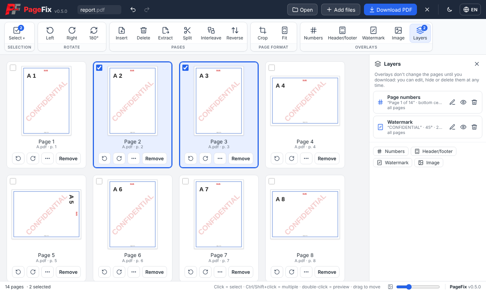
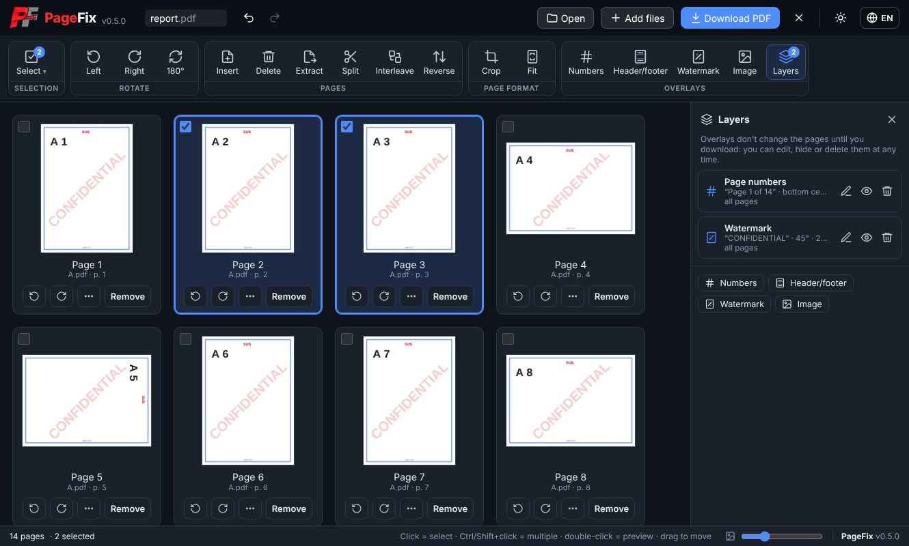
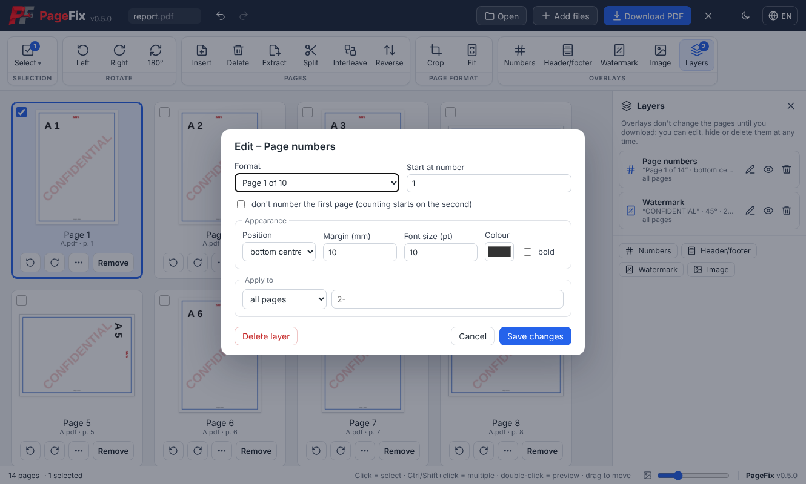
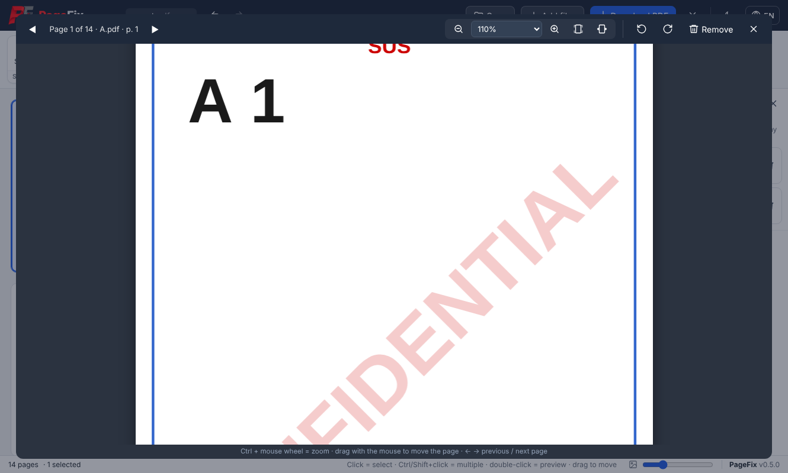

<p align="center">
  
</p>

<h1 align="center">PageFix</h1>

<p align="center">
  <b>A PDF page editor that runs entirely in your browser.</b><br>
  Rotate, delete, insert, reorder, merge, split, crop, number and watermark PDF pages –
  your documents never leave your computer.
</p>

<p align="center">
  <a href="README.ro.md">Română</a> ·
  <a href="#features">Features</a> ·
  <a href="#installation">Installation</a> ·
  <a href="#configuration">Configuration</a> ·
  <a href="#license">License</a>
</p>



## Why PageFix?

- **Private by design** – PDFs are opened, edited and saved **in the browser**. The server only delivers the
  page and the JavaScript libraries; it never receives a document. Ideal for intranets and sensitive files.
- **Works offline** – every library and font is bundled. No CDN, no internet connection, no build step.
- **Simple to host** – plain PHP + static files. Runs on XAMPP, any Apache/Nginx + PHP 8 server,
  or `php -S` for a quick try.
- **Visual** – all pages are shown as thumbnails, each with its own buttons, like in the screenshot above.

## Features

| | |
|---|---|
| **Rotate** | 90° / 180° / 270°, single pages or the selection |
| **Delete** | single pages, a selection, a range, all even or all odd pages |
| **Insert** | blank pages, pages from another PDF, or images (JPG, PNG, WEBP…) as pages – at any position |
| **Extract** | chosen pages (e.g. `2, 5-8, 12`) into a new PDF |
| **Reorder** | drag & drop (multiple pages at once), reverse order, **interleave** two files (front/back scans) |
| **Merge & split** | open or drop several PDFs at once; split per page, every *N* pages or by ranges (`1-3; 4-10; 11-`) → ZIP |
| **Crop & fit** | crop margins by dragging a rectangle (non-destructive CropBox) or fit pages to A4/A3/A5/Letter/Legal |
| **Overlays** | page numbers, header/footer text (`{n}`, `{total}`, `{date}`, `{file}`), diagonal watermark, image/logo |
| **Editable layers** | overlays stay editable until download: edit, hide or delete them from the *Layers* panel |
| **Unicode text** | added text uses an embedded, subsetted TrueType font – diacritics (ă, ș, ț, ü, ł…) are real, searchable text |
| **Preview** | large preview with zoom (10–800 %, fit page / width), Ctrl + mouse wheel zoom at the cursor, drag to pan |
| **Undo / redo** | for every operation (Ctrl+Z / Ctrl+Y) |
| **Themes** | light / dark, one-click toggle in the top bar (first visit follows the operating system) |
| **Languages** | English and Romanian, switchable from the top bar; easy to add more |

<details>
<summary>More screenshots</summary>

**Dark theme**


**Editing a layer**


**Preview with zoom**

</details>

## Installation

Requirements: **PHP 8.1+** (developed with 8.3/8.4) and a recent browser (Chrome, Edge, Firefox, Safari).
No database, no Composer, no Node.js.

**XAMPP / Apache**

1. Copy the `pagefix` folder into `htdocs` (e.g. `C:\xampp\htdocs\pagefix`).
2. Open `http://<server>/pagefix/`.

**Quick local test**

```bash
cd pagefix
php -S localhost:8000
# open http://localhost:8000
```

The included `.htaccess` files set MIME types for `.wasm`/`.mjs` and block direct access to `inc/`.
On Nginx, deny access to `/inc/` and `config*.php` yourself.

## Configuration

`config.php` holds the defaults and is versioned. **Don't edit it** – copy `config.local.example.php` to
`config.local.php` and override only what you need. `config.local.php` is git-ignored, so updates never
overwrite your settings.

```php
<?php
return [
    'ui' => ['language' => 'en', 'theme' => 'auto', 'thumb_size' => 320, 'thumb_size_max' => 800],
];
```

| Key | Meaning |
|---|---|
| `app.name`, `app.version`, `app.tagline` | name, version and tagline (top bar, footer, About dialog, PDF metadata) |
| `app.logo`, `app.logo_large` | logo files (top bar / About dialog); favicons are in `assets/img/` |
| `ui.language` | `en`, `ro` or `auto` (browser language). Users can switch from the top bar (saved in a cookie) |
| `ui.theme` | initial theme: `light`, `dark` or `auto` (follow the OS). Users toggle it from the top bar (saved in the browser) |
| `ui.thumb_size`, `ui.thumb_size_min`, `ui.thumb_size_max` | thumbnail size slider: start value, minimum and maximum in px (50 – 2000; defaults 190, 110, 420). A size chosen earlier with the slider is remembered by the browser and wins over the start value |
| `ui.show_hints`, `ui.preview_fit` | status-bar hints, initial preview zoom (`page` / `width`) |
| `defaults.*` | default watermark text, page-number format and header text (`''` = language default) |

Text values may be a string or a per-language array: `'tagline' => ['en' => '…', 'ro' => '…']`.

The author credit (SEUL, link, e-mail, © year) is built into the code (`AUTHOR_*` constants in `inc/bootstrap.php`)
and is not configurable.

## Keyboard shortcuts

| Keys | Action |
|---|---|
| Ctrl+Z / Ctrl+Y | undo / redo |
| Ctrl+A, Esc | select all / clear selection |
| Delete | remove selected pages |
| Ctrl+S | download PDF |
| F1 | open the user manual (new tab) |
| Double-click a page | open preview |
| In preview: Ctrl+wheel, `+` `−` `0` `W` | zoom, fit page, fit width |
| In preview: ← → / PageUp PageDown | previous / next page |

## Translations

Texts live in `lang/<code>.json` (flat keys; plural forms as `{"one": …, "few": …, "other": …}` following
[CLDR plural rules](https://www.unicode.org/cldr/charts/latest/supplemental/language_plural_rules.html)).

To add a language: copy `lang/en.json` to `lang/<code>.json`, translate the values (keep the `{placeholders}`),
then add the code to `LANGUAGES` in `inc/bootstrap.php`. Missing keys fall back to English.

## How it works

```
index.php            page markup (server-side, translated)
inc/bootstrap.php    configuration, language detection, helpers
lang/*.json          translations
assets/js/app.js     UI: page grid, selection, drag & drop, layers, dialogs, preview (pdf.js)
assets/js/engine.js  PDF operations (pdf-lib): build, crop, fit, overlays, images
assets/js/ttf.js     TrueType embedding with subsetting (Unicode text without fontkit)
assets/js/i18n.js    translations in the browser
manual/ro/           user manual (Romanian, HTML + screenshots), opened with the help button or F1
lib/                 bundled third-party libraries (see THIRD_PARTY_NOTICES.md)
```

- The document is a list of references `{source, page, rotation}`: rotating, deleting, moving and inserting are
  instant and never touch the original files. The final PDF is assembled with pdf-lib only when downloading.
- Crop and fit are applied to an intermediate PDF that becomes a new source (undo returns to the previous one).
- Overlays are layers drawn on top of the thumbnails with the same font and geometry; on export they are written
  into each page through a transformation matrix (no flattening), so links and forms are preserved, and text
  appears “on top” of rotated pages exactly as you see them.

## Known limitations

- *Fit to paper size* turns a page into a Form XObject – links, form fields and comments on those pages are lost
  (cropping and overlays keep everything).
- Encrypted PDFs can be viewed (with password), but pdf-lib cannot decrypt them; saved pages may be blank.
- Interactive forms and digital signatures are not guaranteed to survive merge/extract.
- Very large files are limited by the browser's memory.

## Third-party components

PageFix bundles [pdf.js](https://github.com/mozilla/pdf.js) (Apache-2.0), [pdf-lib](https://github.com/Hopding/pdf-lib) (MIT),
[JSZip](https://github.com/Stuk/jszip) (MIT) and the [Liberation Sans](https://github.com/liberationfonts/liberation-fonts)
font (SIL OFL 1.1). Details and license texts: [THIRD_PARTY_NOTICES.md](THIRD_PARTY_NOTICES.md).

## License

[Apache License 2.0](LICENSE) © 2026 [SEUL](https://code-by-seul.ro/) – see also [NOTICE](NOTICE).
The bundled third-party components keep their own licenses (all permissive and compatible: Apache-2.0, MIT, BSD, CC0, SIL OFL).
