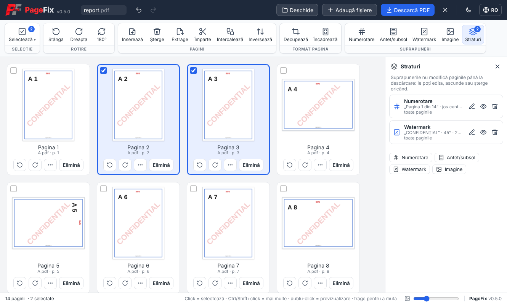

<p align="center">
  
</p>

<h1 align="center">PageFix</h1>

<p align="center">
  <b>Editor de pagini PDF care rulează integral în browser.</b><br>
  Rotești, ștergi, inserezi, reordonezi, combini, împarți, decupezi, numerotezi și pui watermark –
  documentele nu părăsesc calculatorul tău.
</p>

<p align="center"><a href="README.md">English</a></p>



## De ce PageFix?

- **Confidențial prin construcție** – PDF-urile se deschid, se modifică și se salvează **în browser**. Serverul doar
  livrează pagina și librăriile JavaScript; nu primește niciodată documentul. Potrivit pentru intranet și documente sensibile.
- **Funcționează offline** – toate librăriile și fonturile sunt incluse. Fără CDN, fără internet, fără compilare.
- **Ușor de găzduit** – PHP simplu + fișiere statice. Merge pe XAMPP, pe orice server Apache/Nginx cu PHP 8 sau cu `php -S`.

## Funcții

| | |
|---|---|
| **Rotire** | 90° / 180° / 270°, pe pagină sau pe selecție |
| **Ștergere** | pagini individuale, selecție, interval, toate paginile pare sau impare |
| **Inserare** | pagini albe, pagini din alt PDF sau imagini ca pagini – în orice poziție |
| **Extragere** | paginile alese (ex. `2, 5-8, 12`) într-un PDF nou |
| **Reordonare** | drag & drop (și mai multe pagini deodată), inversare, **intercalare** cu alt fișier (față/verso) |
| **Combinare și împărțire** | mai multe PDF-uri deodată; împărțire pe pagini, la *N* pagini sau pe intervale → ZIP |
| **Decupare și încadrare** | decupare margini cu mouse-ul (CropBox, nedistructiv) sau încadrare în A4/A3/A5/Letter/Legal |
| **Suprapuneri** | numere de pagină, antet/subsol (`{n}`, `{total}`, `{date}`, `{file}`), watermark, imagine/logo |
| **Straturi editabile** | suprapunerile rămân editabile până la descărcare (panoul *Straturi*: editează / ascunde / șterge) |
| **Diacritice** | textul adăugat folosește un font TrueType încorporat (subset) – ă, â, î, ș, ț sunt text real, căutabil |
| **Previzualizare** | zoom 10–800 %, toată pagina / pe lățime, Ctrl + rotiță în punctul cursorului, deplasare cu mouse-ul |
| **Anulare / refacere** | pentru orice operație (Ctrl+Z / Ctrl+Y) |
| **Teme** | luminoasă / întunecată, comutare cu un click din bara de sus (la prima vizită, după sistem) |
| **Limbi** | română și engleză, comutabile din bara de sus |
| **Manual de utilizare** | în română, cu capturi de ecran (`manual/ro/`); se deschide cu butonul **?** din bara de sus sau cu **F1** |

## Instalare

Cerințe: **PHP 8.1+** și un browser recent. Fără bază de date, Composer sau Node.js.

1. Copiază folderul `pagefix` în `htdocs` (ex. `C:\xampp\htdocs\pagefix`).
2. Deschide `http://<server>/pagefix/`.

Test rapid: `cd pagefix && php -S localhost:8000`, apoi `http://localhost:8000`.

## Configurare

`config.php` conține valorile implicite și se află în repository – **nu-l modifica**. Copiază
`config.local.example.php` ca `config.local.php` și scrie acolo doar ce vrei să schimbi
(limbă, temă, mărimea miniaturilor…). `config.local.php` e ignorat de git, deci actualizările nu-ți suprascriu setările.
Se citește după `config.php`; câmpurile goale (`''`) din el nu suprascriu nimic. Fereastra „Despre” arată ce fișiere de configurare au fost citite.

```php
<?php
return [
    'ui' => ['language' => 'ro', 'theme' => 'auto', 'thumb_size' => 320, 'thumb_size_max' => 800],
];
```

Mărimea miniaturilor: `thumb_size` (valoarea de pornire), `thumb_size_min` și `thumb_size_max` (limitele glisorului), în px,
între 50 și 2000. O mărime aleasă anterior cu glisorul e reținută de browser și are prioritate față de valoarea de pornire.

Autorul (SEUL, link, e-mail, anul ©) este integrat în cod (constantele `AUTHOR_*` din `inc/bootstrap.php`) și nu se configurează.

Lista completă a cheilor e în [README.md](README.md#configuration) și în comentariile din `config.php`.
Textele interfeței (inclusiv „un produs …” din subsol) sunt în `lang/ro.json` și `lang/en.json`.

## Licență

[Apache License 2.0](LICENSE) © 2026 [SEUL](https://code-by-seul.ro/) – vezi și [NOTICE](NOTICE). Componentele terțe incluse își păstrează licențele
(toate permisive și compatibile: Apache-2.0, MIT, BSD, CC0, SIL OFL) – vezi [THIRD_PARTY_NOTICES.md](THIRD_PARTY_NOTICES.md).
